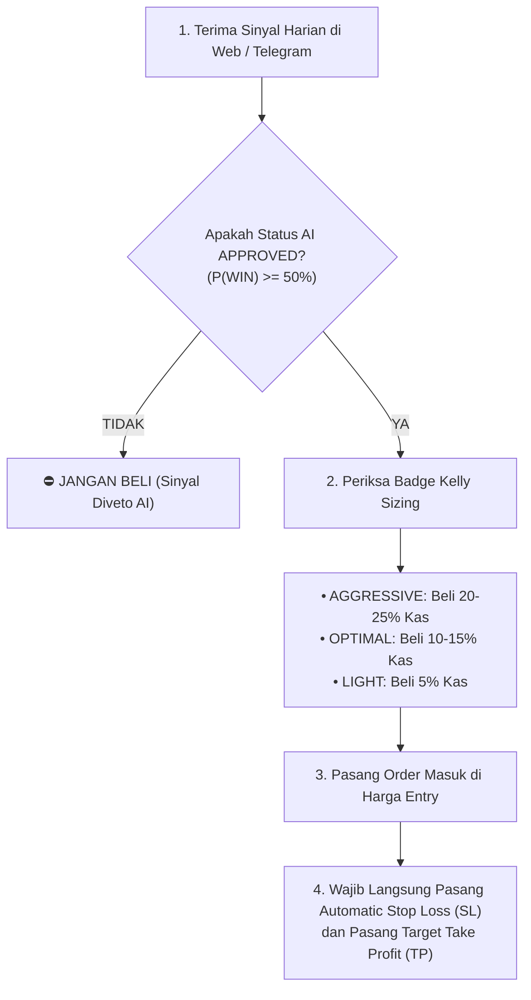

# 🦉 Panduan Pengguna: Memahami AI & Machine Learning di The Investowl

> **Panduan Praktis Trader & Investor Saham Bursa Efek Indonesia (IDX)**  
> **Target Audiens**: Pengguna Web InvestOwl, Pengguna Telegram Bot (@IDXadryanBot), dan Algorithmic Trader  
> **Terakhir Diperbarui**: Oktober 2026

---

## 📑 Daftar Isi
1. [Pengantar: Mengapa InvestOwl Menggunakan Machine Learning?](#1-pengantar-mengapa-investowl-menggunakan-machine-learning)
2. [Memahami 4 Metrik Kuantitatif AI di Layar Anda](#2-memahami-4-metrik-kuantitatif-ai-di-layar-anda)
   - [2.1 AI Win Probability (P(WIN))](#21-ai-win-probability-pwin)
   - [2.2 Expected Drawdown (MAE - Maximum Adverse Excursion)](#22-expected-drawdown-mae---maximum-adverse-excursion)
   - [2.3 Expected Runup (MFE - Maximum Favorable Excursion)](#23-expected-runup-mfe---maximum-favorable-excursion)
   - [2.4 Badge Alokasi Modal Dinamis (Half-Kelly Sizing)](#24-badge-alokasi-modal-dinamis-half-kelly-sizing)
3. [Peran AI Gatekeeper: Mengapa Sinyal Skor Tinggi Bisa Ditolak?](#3-peran-ai-gatekeeper-mengapa-sinyal-skor-tinggi-bisa-ditolak)
4. [Panduan Langkah Demi Langkah Mengeksekusi Sinyal AI](#4-panduan-langkah-demi-langkah-mengeksekusi-sinyal-ai)
5. [Tanya Jawab (FAQ) & Jebakan Psikologi Trader](#5-tanya-jawab-faq--jebakan-psikologi-trader)

---

## 1. Pengantar: Mengapa InvestOwl Menggunakan Machine Learning?

Di pasar saham, trader sering terjebak dalam dua kubu ekstrim:
1. **Kubu Indikator Subjektif**: Membaca pola grafik berdasarkan intuisi mata, yang sering menghasilkan keputusan emosional (*FOMO* saat harga pucuk atau panik saat koreksi wajar).
2. **Kubu Black-Box AI Naif**: Menggunakan AI yang mencoba menebak harga esok hari seperti bola kristal, yang hampir selalu gagal di pasar riil karena pasar finansial dipenuhi *noise*.

**The Investowl mengambil pendekatan kuantitatif berstandar Hedge Fund:**
- **Analisis Aturan (Rule-Based)** mencari pola akumulasi dana institusi (*Smart Money / Bandarmologi*), siklus pasar Wyckoff, dan pola kontraksi volatilitas (Minervini VCP).
- **Machine Learning (AI Meta-Labeler)** bertindak sebagai **Risk Auditor & Gatekeeper** independen. AI mengevaluasi 28 metrik kuantitatif secara dingin dan objektif untuk menjawab: *"Secara statistik historis, apakah pola seperti ini layak diambil risikonya? Dan berapa porsi modal yang aman?"*.

---

## 2. Memahami 4 Metrik Kuantitatif AI di Layar Anda

Saat Anda membuka menu **Signal** di web InvestOwl (`/signal`) atau menerima notifikasi di Telegram, Anda akan melihat indikator AI berikut:

```
┌────────────────────────────────────────────────────────┐
│ 🟢 BBCA · Phase D (Sign of Strength) · VCP A           │
│ Skor Sistem: 78/100                                    │
│ 🤖 AI Win Prob: 68.4% (APPROVED)                       │
│ 📉 Exp. Drawdown (MAE): -4.2%  | 📈 Exp. Runup: +14.8%  │
│ 💰 Kelly Allocation: ⚡ OPTIMAL (15% Portfolio)        │
└────────────────────────────────────────────────────────┘
```

---

### 2.1 AI Win Probability (P(WIN))
- **Apa ini?**  
  Probabilitas matematis bahwa sinyal ini akan menyentuh target Take Profit (TP) sebelum menyentuh Stop Loss (SL) dalam rentang waktu penahanan maksimal 20 hari bursa.
- **Bagaimana membacanya?**  
  Nilai probabilitas di InvestOwl telah melalui proses **Kalibrasi Probabilitas (Platt Scaling)**. Ini bukan angka tebakan acak. Jika sistem menulis `68%`, itu berarti dari 100 saham dengan pola serupa di masa lalu, sekitar 68 saham berhasil mencetak profit.
- **Mengapa Angka $\ge 50\%$ Sangat Kuat?**  
  Di bursa saham Indonesia (IDX), jika Anda memilih saham secara acak dengan rasio Risk-to-Reward $2:1$, peluang menang alami pasar (*random baseline*) hanya berkisar **$15.6\%$**. Oleh karena itu, probabilitas AI di atas $50\%$ adalah keunggulan statistik (*statistical edge*) yang sangat signifikan!

---

### 2.2 Expected Drawdown (MAE - Maximum Adverse Excursion)
- **Apa ini?**  
  Estimasi penurunan harga terdalam (*floating loss*) yang diperkirakan akan dialami oleh saham tersebut selama Anda menahannya, sebelum akhirnya bergerak naik.
- **Contoh Kasus:**  
  Jika Anda membeli saham di harga Rp 1.000 dan model memprediksi **MAE = -4.5%**, maka ada kemungkinan harga akan sempat turun ke sekitar Rp 955 sebelum memantul.
- **Manfaat untuk Trader:**  
  Mencegah kepanikan! Anda tidak akan kaget atau panik menjual di harga bawah jika koreksi yang terjadi masih berada dalam batas toleransi MAE yang diprediksi oleh AI.

---

### 2.3 Expected Runup (MFE - Maximum Favorable Excursion)
- **Apa ini?**  
  Estimasi lonjakan keuntungan tertinggi (*floating profit*) yang berpotensi dicapai oleh saham tersebut selama periode ayunan (*swing cycle* 20 hari).
- **Contoh Kasus:**  
  Jika model memprediksi **MFE = +16.0%**, Anda memiliki gambaran objektif mengenai potensi kenaikan maksimum saham tersebut, sehingga Anda dapat memasang target Take Profit bertahap secara realistis.

---

### 2.4 Badge Alokasi Modal Dinamis (Half-Kelly Sizing)
Sistem InvestOwl tidak membiarkan Anda menebak-nebak berapa lot saham yang harus dibeli. Berdasarkan perbandingan antara peluang menang ($P(\text{WIN})$), potensi cuan (MFE), dan risiko penurunan (MAE), sistem menghitung ukuran posisi modal menggunakan rumus **Half-Kelly Criterion**:

| Badge Alokasi | Makna Kuantitatif | Panduan Eksekusi Modal Anda |
|---|---|---|
| `🔥 AGGRESSIVE (20-25%)` | Peluang menang tinggi dan potensi MFE jauh lebih besar dari MAE. | Alokasikan porsi modal maksimal (maksimal 20% – 25% dari total portofolio kas Anda). |
| `⚡ OPTIMAL (10-19%)` | Setup standar institusional yang sangat ideal dan berimbang. | Alokasikan posisi inti portofolio (10% – 15% dari total modal kas Anda). |
| `🛡️ LIGHT (1-9%)` | Sinyal valid, namun memiliki volatilitas tinggi atau potensi imbal hasil moderat. | Masuk dengan porsi rintisan (*scout order*), sekitar 5% – 8% modal kas. |
| `⛔ SKIP / NO ALLOC` | Rasio imbal hasil terhadap risiko buruk atau probabilitas rendah. | **JANGAN BELI**. Sinyal ditolak oleh AI demi keselamatan portofolio Anda. |

---

## 3. Peran AI Gatekeeper: Mengapa Sinyal Skor Tinggi Bisa Ditolak?

Anda mungkin pernah melihat suatu saham memiliki skor teknikal dan bandar yang tinggi (misal: **Skor 74**), namun di kolom status AI tertulis **⛔ REJECTED / VETOED**.

### Mengapa Hal Ini Terjadi?
1. **Deteksi Bull Trap / False Breakout**: Sistem aturan mungkin melihat ada akumulasi volume besar hari ini. Namun, AI mengamati variabel mikro (misal: lonjakan foreign net sell 60-hari, divergence Chaikin Money Flow, atau kemiringan OBV yang rapuh) yang sering kali berujung pada jebakan *bull trap*.
2. **Ekskursi Risiko Terlalu Dalam**: Jika AI menghitung potensi drawdown (MAE) sebesar $-9.5\%$ sementara potensi kenaikan (MFE) hanya $+6\%$, mengambil sinyal tersebut adalah tindakan ceroboh secara kuantitatif. AI akan langsung memveto sinyal tersebut.
3. **Penyelamat Modal**: Fungsi utama AI Gatekeeper bukanlah memperbanyak sinyal, melainkan **menghindarkan Anda dari kerugian modal yang tidak perlu**.

---

## 4. Panduan Langkah Demi Langkah Mengeksekusi Sinyal AI

Ikuti disiplin 4 langkah berikut saat mengeksekusi rekomendasi harian:



1. **Langkah 1: Periksa Status AI Approval**  
   Fokuskan perhatian hanya pada emiten yang lolos persetujuan AI (*Approved* dengan probabilitas $\ge 50\%$). Abaikan saham yang ditolak.
2. **Langkah 2: Tentukan Ukuran Lot Berdasarkan Badge Kelly**  
   Sesuaikan modal yang Anda belikan dengan badge alokasi. Jangan pernah memasukkan 100% seluruh modal kas Anda ke dalam satu saham (*all-in*), apa pun rekomendasinya!
3. **Langkah 3: Pasang Automatic Stop Loss Sejak Hari Pertama**  
   Gunakan fitur *Auto Order / Trailing Stop* di aplikasi sekuritas Anda sesuai harga Stop Loss (SL) yang tertera di kartu sinyal.
4. **Langkah 4: Amankan Keuntungan Secara Bertahap**  
   Ketika harga saham telah mencapai level kenaikan separuh target TP atau mendekati level MFE yang diprediksi, naikkan Stop Loss Anda ke harga beli (*Trailing Stop / Breakeven*) untuk mengunci keuntungan.

---

## 5. Tanya Jawab (FAQ) & Jebakan Psikologi Trader

### Q1: Apakah saham dengan AI Win Prob 70% dijamin pasti untung?
> **Tidak ada jaminan 100% di pasar saham.** Probabilitas 70% berarti ada peluang 30% sinyal tersebut akan mengalami Stop Loss. Perbedaan antara trader profesional dan amatir adalah: trader profesional menerima kerugian 30% tersebut dengan disiplin memotong rugi (*cut loss*), sementara saat menang 70%, mereka memaksimalkan keuntungan dengan manajemen modal Kelly yang tepat.

### Q2: Bolehkah saya mengabaikan Stop Loss jika AI Win Probability sangat tinggi?
> **DILARANG KERAS.** Mengabaikan Stop Loss adalah jalan pintas menuju kehancuran portofolio. Model AI dirancang dengan asumsi bahwa Stop Loss selalu dipatuhi secara ketat. Jika Anda membiarkan kerugian membengkak melebihi batas SL, seluruh kalkulasi matematis probabilitas dan formula Kelly menjadi tidak berlaku.

### Q3: Mengapa prediksi MAE saya -5%, tetapi harga turun -7% dan kena SL?
> MAE adalah nilai ekspektasi rata-rata statistik (*expected value*). Pada kondisi pasar tertentu (misalnya sentimen geopolitik mendadak atau penurunan tajam IHSG), harga bisa bergerak melampaui rata-rata historisnya. Inilah alasan mengapa Stop Loss absolut tetap dipasang sebagai jaring pengaman terakhir.

### Q4: Kapan waktu terbaik untuk membeli saham dari hasil scanner?
> Scanner dijalankan pada malam hari (20:00 WIB) setelah pasar tutup. Waktu terbaik mengeksekusi order adalah pada sesi **Pra-Pembukaan (08:45 – 08:55 WIB)** atau **15 menit pertama setelah pembukaan pasar (09:00 – 09:15 WIB)**, dengan memastikan harga pembukaan tidak melonjak terlalu jauh di atas harga *Entry* rekomendasi (maksimal toleransi lonjakan $+1.5\%$).
